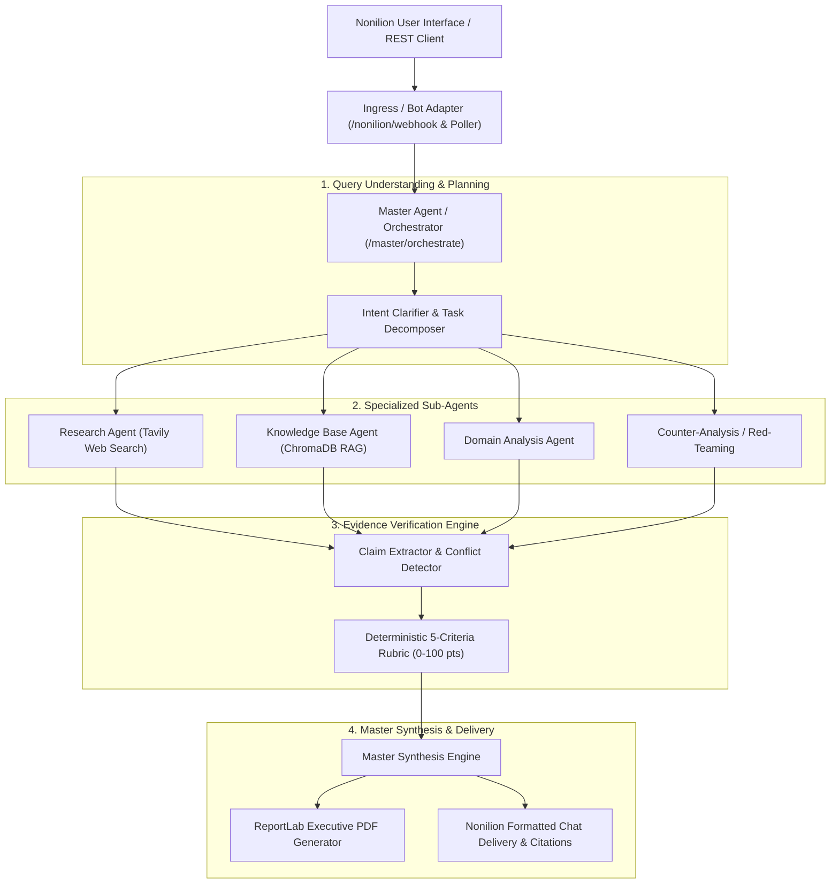

# Veritas AI — Collaborative Multi-Agent Intelligence & Evidence Verification System

**INNOVORTEX 4.0 — Nonilion Track**

Veritas AI is an evidence-first multi-agent system. Instead of simply aggregating generated answers or producing unverified model confidence percentages, Veritas AI coordinates specialized sub-agents, cross-examines findings against traceable sources, stress-tests claims through adversarial counter-analysis, and computes a transparent, deterministic evidence-strength score.

---

## Architecture Overview



---

## Key Features

1. **Master Agent & Central Orchestrator**:
   - Understands user queries and evaluates intent clarity.
   - Detects ambiguous or under-specified inquiries early and requests clarification before performing expensive work.
   - Decomposes complex tasks into bounded sub-tasks with assigned agent roles.
   - Preserves complete execution traces with timestamps and step data.

2. **Specialized Sub-Agent Delegation**:
   - **Research Agent**: Live authoritative web research with source URLs, publication dates, and excerpts.
   - **Knowledge-Base Agent**: Semantic vector search (ChromaDB) over ingested internal documents (PDF, DOCX, TXT, CSV).
   - **Domain Analysis Agent**: Technical interpretation and operational feasibility analysis.
   - **Counter-Analysis Agent**: Adversarial stress-testing, uncovering dissenting sources, unverified assumptions, and conflicting data.

3. **Evidence Verification Engine & Deterministic Rubric**:
   - Extracts discrete factual claims from draft findings.
   - Evaluates claims with a deterministic 0-100 scoring code (not an LLM guess):
     - **Source Authority (30 pts)**: Official/gov/academic vs reputable industry vs unverified blog.
     - **Independent Corroboration (25 pts)**: $\ge$2 independent sources vs single source vs uncorroborated.
     - **Direct Relevance (20 pts)**: Explicit textual match vs inferred vs tangential.
     - **Recency (15 pts)**: Within current window vs dated vs undated.
     - **Contradiction Handling (10 pts)**: Conflicts disclosed and resolved vs unresolved contradiction.
   - Classifies each claim into: `VERIFIED`, `PARTIALLY_SUPPORTED`, `DISPUTED`, or `UNVERIFIED`.
   - Explicitly displays deductions, missing evidence, and heuristic score label.

4. **Nonilion Bot API Integration**:
   - **Pairing Handshake**: One-time pairing code integration via `/nonilion/pair` from the Nonilion room's Agents dock robot button.
   - **Ingress Webhook**: `/nonilion/webhook` handles room mentions, direct messages, and chat events.
   - **Background Poller**: Built-in polling client (`NonilionPoller`) for environments behind NAT or local firewalls.
   - **Chat Delivery**: Formatted chat replies with evidence strength badges, claim breakdowns, citations, and report download links.

5. **ReportLab Executive PDF Deliverable**:
   - Generates executive PDF reports including score cards, claim verification matrices, references, and disclosed limitations.
   - Accessible and downloadable via `/master/reports/{report_id}/pdf`.

---

## Quickstart

### 1. Setup Virtual Environment & Dependencies
```bash
python -m venv .venv

# On Linux/macOS:
source .venv/bin/activate
# On Windows:
.\.venv\Scripts\Activate.ps1

pip install -r requirements.txt
cp .env.example .env
```

### 2. Configure Environment (Optional)
Edit `.env`:
```ini
# Optional external providers:
TAVILY_API_KEY=your_tavily_api_key
GEMINI_API_KEY=your_gemini_api_key
GEMINI_MODEL=gemini-2.0-flash

# Nonilion Bot settings:
NONILION_BOT_NAME="Veritas AI Master"
NONILION_API_URL=https://api.nonilion.com/v1
NONILION_BOT_TOKEN=your_token
NONILION_ROOM_ID=your_room_id
```
*Note: Without external API keys, all endpoints remain fully operational with deterministic heuristic analysis and offline evidence verification.*

### 3. Run the Backend Server
```bash
uvicorn app.main:app --reload --host 0.0.0.0 --port 8000
```
- Interactive Swagger UI: `http://127.0.0.1:8000/docs`
- Health check: `http://127.0.0.1:8000/health`

### 4. Run Test Suite
```bash
pytest
```

---

## API Reference

### Master Agent Endpoints
- `POST /master/orchestrate`: Run end-to-end Master Agent workflow (decompose $\rightarrow$ delegate $\rightarrow$ verify $\rightarrow$ synthesize $\rightarrow$ PDF).
- `POST /master/decompose`: Decompose a query into sub-tasks with assigned agent roles.
- `POST /master/verify`: Run claim-level verification and deterministic rubric scoring on provided claims and evidence.
- `POST /master/synthesize`: Synthesize executive summary and detailed analysis from verified claims.
- `GET /master/reports/{report_id}/pdf`: Download generated ReportLab executive PDF report.
- `GET /master/trace/{task_id}`: Inspect execution trace, timestamps, and sub-agent step data.

### Nonilion Integration Endpoints
- `POST /nonilion/webhook`: Webhook ingress endpoint for Nonilion room chat events.
- `POST /nonilion/pair`: Pair bot with room using the one-time pairing code from Nonilion dock.
- `GET /nonilion/status`: Check connection, pairing status, and poller state.
- `POST /nonilion/poller/start`: Start background polling worker.
- `POST /nonilion/poller/stop`: Stop background polling worker.

### Research & Knowledge Base Endpoints
- `POST /research`: Research sub-agent query endpoint.
- `POST /documents/upload`: Upload and index PDF/DOCX/TXT/CSV files into ChromaDB vector store.
- `GET /documents`: List indexed documents.
- `POST /knowledge-base/search`: Semantic chunk retrieval.

---

## Example Master Orchestration Request

```json
POST /master/orchestrate
{
  "query": "Evaluate the technical and economic feasibility of sodium-ion batteries for grid storage",
  "include_web": true,
  "include_knowledge_base": true,
  "generate_pdf": true,
  "top_k": 5
}
```

### Example Response
```json
{
  "task_id": "task-8f921ab0",
  "query": "Evaluate the technical and economic feasibility of sodium-ion batteries for grid storage",
  "status": "completed",
  "clarification_needed": false,
  "executive_summary": "**Veritas AI Executive Summary**\n**Evidence Strength:** 84/100 (Heuristic)...",
  "evidence_strength": {
    "overall_score": 84,
    "label": "heuristic",
    "verified_claims_count": 3,
    "partially_supported_count": 1,
    "disputed_claims_count": 0,
    "rubric_breakdown": {
      "source_authority": 28.0,
      "independent_corroboration": 22.0,
      "direct_relevance": 18.0,
      "recency": 12.0,
      "contradiction_handling": 9.0
    },
    "explanation": "Evidence strength: 84/100 (heuristic). 3 of 4 claim(s) verified; 1 partially supported...",
    "deductions": []
  },
  "claims": [
    {
      "claim_id": "claim-1a2b3c4d",
      "statement": "Sodium-ion batteries utilize abundant sodium precursors resulting in lower raw material costs.",
      "relationship": "supports",
      "source_quality": "primary",
      "status": "verified",
      "rubric_score": 88
    }
  ],
  "report_id": "report-9876543210",
  "pdf_download_url": "/master/reports/report-9876543210/pdf"
}
```
